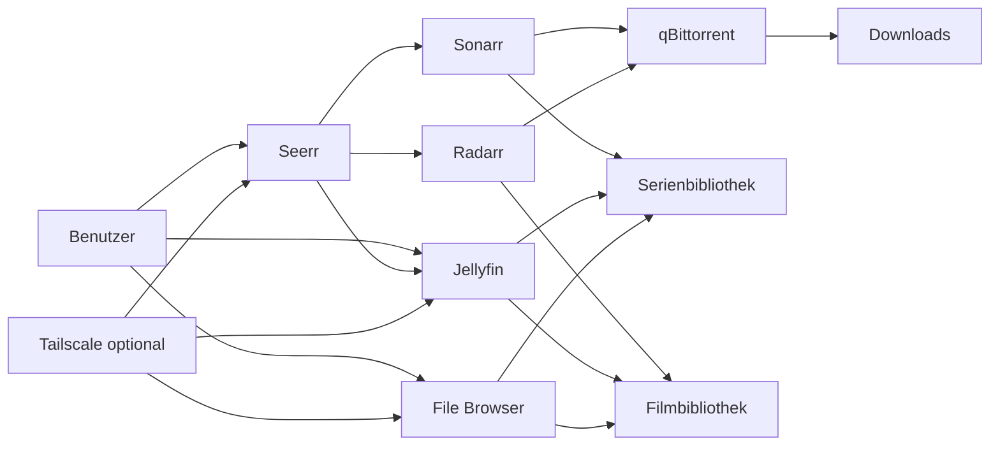

# Jellyfin Enhanced Setup


Ein möglichst automatisiertes, reproduzierbares und nutzerfreundliches Medienserver-Setup auf Basis von Docker Compose. Das Projekt bündelt Jellyfin, Seerr, Sonarr, Radarr, qBittorrent und File Browser in einem gemeinsamen Stack. Optional kann Tailscale für privaten Fernzugriff verwendet werden.

> [!IMPORTANT]
> Dieses Repository ist noch **Work in Progress**. Die vorhandenen Skripte und Konfigurationsdateien bilden Zielbild und bisherigen Entwicklungsstand ab, sind aber nicht als vollständig geprüft oder für jede Umgebung fehlerfrei anzusehen. Vor produktiver Nutzung müssen insbesondere Pfade, Berechtigungen, Zugangsdaten, Netzwerkfreigaben und Sicherungen geprüft werden.

## Zielbild

Das Projekt soll langfristig eine möglichst echte Out-of-the-box-Erfahrung bieten:

1. Repository auf einen unterstützten Linux-Host kopieren oder klonen.
2. Ein einziges Setup-Skript starten.
3. Das Skript prüft Voraussetzungen, installiert beziehungsweise konfiguriert die benötigten Komponenten und legt alle Verzeichnisse an.
4. Der Docker-Stack wird validiert und gestartet.
5. Die Dienste sind anschließend über klar dokumentierte lokale Adressen erreichbar.
6. Wiederholte Ausführung beschädigt keine vorhandene Installation.
7. Ein Reset ist bewusst, nachvollziehbar und gegen versehentliche Datenlöschung abgesichert.

Der gewünschte Endzustand ist nicht nur „Container starten“, sondern ein zusammenhängendes System mit konsistenten Pfaden, verständlicher Bedienung, sinnvoller Rechtevergabe und klaren nächsten Schritten.

## Enthaltene Dienste

| Dienst | Zweck | Standard-Port |
|---|---|---:|
| Jellyfin | Medienserver und zentrale Benutzeroberfläche | `8096` |
| Seerr | Nutzerfreundliche Medienanfragen | `5055` |
| Sonarr | Verwaltung von Serien | `8989` |
| Radarr | Verwaltung von Filmen | `7878` |
| qBittorrent | Download-Client | `8080` |
| File Browser | Webbasierte Dateiverwaltung | `8091` |
| Tailscale | Optionaler privater Fernzugriff | kein fester Web-Port |

## Zusammenspiel der Komponenten



Seerr nimmt Medienwünsche entgegen und übergibt sie an Sonarr oder Radarr. Diese steuern qBittorrent an und übernehmen anschließend die Organisation der Dateien. Jellyfin liest die fertigen Medienbibliotheken ein. File Browser dient der manuellen Dateiverwaltung. Tailscale kann einen geschützten Zugriff außerhalb des lokalen Netzes ermöglichen.

## Repository-Struktur

Je nach Entwicklungsstand können einzelne Dateien noch fehlen oder umbenannt werden. Vorgesehen beziehungsweise bereits vorhanden sind:

```text
.
├── compose.yaml
├── .env.example
├── .gitignore
├── README.md
├── setup.md
├── setup.sh
├── seerr-setup.sh
├── reset.sh
├── jellyfin.css
└── life-tv.html
```

### Bedeutung der Dateien

- `compose.yaml`: Definition des vollständigen Docker-Stacks, seiner Netzwerke, Volumes, Ports und optionalen Profile.
- `.env.example`: Vorlage für lokale Einstellungen wie Zeitzone, Benutzer- und Gruppen-ID, Medienpfade und Tailscale-Parameter.
- `setup.sh`: Zentrales Setup-Skript. Es soll Voraussetzungen prüfen, Verzeichnisse vorbereiten, Konfigurationen erzeugen, den Compose-Stack validieren und starten.
- `setup.md`: Ergänzende Entwicklungs- und Setup-Dokumentation.
- `seerr-setup.sh`: Hilfsskript für die Einrichtung beziehungsweise Anbindung von Seerr. Der aktuelle Stand ist nicht als universell funktionsfähig anzusehen.
- `reset.sh`: Rücksetzroutine. Sie muss besonders defensiv arbeiten und darf persistente Daten nicht ohne eindeutige Warnung und bewusste Bestätigung löschen.
- `jellyfin.css`: Angepasstes Jellyfin-Design mit transparenten Oberflächen, Hintergrundeffekten und Änderungen an einzelnen Bedienelementen.
- `life-tv.html`: Arbeitsstand beziehungsweise Hilfsdatei für Live-TV-/IPTV-Inhalte. Vor Nutzung müssen Quellen, Verfügbarkeit und rechtliche Zulässigkeit eigenständig geprüft werden.

## Voraussetzungen

Empfohlen wird ein aktueller Linux-Server mit:

- 64-Bit-System
- funktionierendem Internetzugang für Image-Downloads
- einem Benutzer mit `sudo`-Berechtigung
- ausreichend freiem Speicherplatz für Medien und Downloads
- Docker Engine mit Docker-Compose-Plugin
- freien Ports für die aktivierten Dienste

Optional:

- Tailscale-Konto und Auth-Key für automatisierte Registrierung
- unterstützte GPU beziehungsweise passende Gerätedurchreichung für Hardware-Transcoding
- Domain oder Reverse Proxy, falls Dienste bewusst öffentlich bereitgestellt werden sollen

> [!WARNING]
> Verwaltungsoberflächen wie qBittorrent, Sonarr, Radarr oder File Browser sollten nicht ungeschützt direkt ins öffentliche Internet gestellt werden. Für Fernzugriff sind ein privates Overlay-Netz wie Tailscale oder ein sauber abgesicherter Reverse Proxy mit HTTPS und zusätzlicher Authentisierung vorzuziehen.

## Schnellstart

### 1. Repository vorbereiten

```bash
git clone https://github.com/florianthepro/jellyfin-enhanced-setup.git
cd jellyfin-enhanced-setup
```

Alternativ können die Dateien direkt in ein lokales Projektverzeichnis kopiert werden.

### 2. Umgebung konfigurieren

```bash
cp .env.example .env
nano .env
```

Beispielwerte:

```dotenv
TZ=Europe/Berlin
PUID=1000
PGID=1000
MEDIA_DIR=/srv/media
DOWNLOAD_DIR=/srv/media/downloads
TAILSCALE_HOSTNAME=media-server
TAILSCALE_AUTHKEY=
```

Die eigenen IDs können so ermittelt werden:

```bash
id -u
id -g
```

### 3. Automatisiertes Setup starten

```bash
chmod +x setup.sh
sudo ./setup.sh
```

Das Setup sollte vor jeder Änderung verständlich ausgeben, was geprüft, erstellt oder gestartet wird. Da das Skript noch in Entwicklung ist, sollten seine Aktionen vor produktiver Verwendung gelesen und in einer Testumgebung geprüft werden.

### 4. Manueller Start als Fallback

Falls das Setup-Skript noch nicht zur Umgebung passt:

```bash
mkdir -p runtime/{jellyfin/{config,cache},seerr/config,sonarr/config,radarr/config,qbittorrent/config,filebrowser/{database,config}}
sudo mkdir -p "${MEDIA_DIR:-/srv/media}"/{movies,series,downloads}
sudo chown -R "$(id -u):$(id -g)" runtime "${MEDIA_DIR:-/srv/media}"
docker compose config
docker compose pull
docker compose up -d
```

### 5. Status prüfen

```bash
docker compose ps
docker compose logs --tail=100
```

## Weboberflächen

Ersetze `SERVER-IP` durch die IP-Adresse oder den DNS-Namen des Hosts.

- Jellyfin: `http://SERVER-IP:8096`
- Seerr: `http://SERVER-IP:5055`
- Sonarr: `http://SERVER-IP:8989`
- Radarr: `http://SERVER-IP:7878`
- qBittorrent: `http://SERVER-IP:8080`
- File Browser: `http://SERVER-IP:8091`

## Ersteinrichtung der Dienste

### Jellyfin

1. Administratorkonto mit einem eigenen starken Kennwort anlegen.
2. Bibliothek **Filme** mit dem Containerpfad `/media/movies` erstellen.
3. Bibliothek **Serien** mit dem Containerpfad `/media/series` erstellen.
4. Sprache, Metadatenanbieter und Zugriffsrechte prüfen.
5. Optional Hardware-Transcoding erst nach erfolgreicher Gerätedurchreichung aktivieren.
6. Bei Bedarf den Inhalt aus `jellyfin.css` unter **Dashboard → Allgemein → Benutzerdefiniertes CSS** einfügen.

### qBittorrent

1. Sofort ein eigenes Administratorkennwort setzen.
2. Downloadpfad auf `/downloads` konfigurieren.
3. Temporäre und abgeschlossene Downloads bei Bedarf getrennt ablegen.
4. Die Weboberfläche nicht ungefiltert öffentlich freigeben.

### Sonarr

1. Root-Ordner `/media/series` hinzufügen.
2. qBittorrent als Download-Client eintragen.
3. Innerhalb des Compose-Netzwerks den Hostnamen `qbittorrent` und Port `8080` verwenden.
4. Qualitätsprofile, Sprache und Benennungsregeln bewusst konfigurieren.

### Radarr

1. Root-Ordner `/media/movies` hinzufügen.
2. qBittorrent als Download-Client eintragen.
3. Innerhalb des Compose-Netzwerks den Hostnamen `qbittorrent` und Port `8080` verwenden.
4. Qualitätsprofile und Benennungsregeln prüfen.

### Seerr

Die interne Kommunikation sollte über die Compose-Dienstnamen erfolgen:

- Jellyfin: `http://jellyfin:8096`
- Sonarr: `http://sonarr:8989`
- Radarr: `http://radarr:7878`

API-Schlüssel müssen aus den jeweiligen Verwaltungsoberflächen übernommen werden. Sie gehören nicht in das öffentliche Repository.

### File Browser

1. Beim ersten Start die Zugangsdaten ändern.
2. Den sichtbaren Basisordner und die Schreibrechte prüfen.
3. Nur benötigte Benutzerkonten und Berechtigungen anlegen.

## Medien- und Containerpfade

Alle Dienste müssen dieselben Dateien unter konsistenten Containerpfaden sehen. Andernfalls funktionieren Übergaben, Imports und Bibliotheksupdates nicht zuverlässig.

Empfohlene Hoststruktur:

```text
/srv/media/
├── movies/
├── series/
└── downloads/
```

Empfohlene Containerpfade:

```text
/media/movies
/media/series
/downloads
```

Sonarr, Radarr und qBittorrent benötigen Schreibzugriff auf die für sie vorgesehenen Verzeichnisse. Jellyfin sollte nach Möglichkeit nur die Rechte erhalten, die zum Lesen der Bibliotheken und Schreiben seiner eigenen Konfiguration notwendig sind.

## Optionaler Fernzugriff mit Tailscale

Wenn der Compose-Stack ein optionales Profil `remote` enthält, kann es nach Eintragung eines Auth-Keys gestartet werden:

```bash
nano .env
docker compose --profile remote up -d
```

Status und Logs:

```bash
docker compose --profile remote ps
docker compose logs -f tailscale
```

Ein Auth-Key ist ein Geheimnis und darf nicht committet werden. Ob Tailscale Funnel eingesetzt wird, muss bewusst entschieden werden, weil Funnel einen Dienst öffentlich erreichbar machen kann. Ein privater Zugriff innerhalb des eigenen Tailnets ist davon zu unterscheiden.

## Live TV und IPTV

`life-tv.html` dokumentiert beziehungsweise unterstützt den bisherigen Arbeitsstand rund um Live-TV-Quellen. Dabei gelten folgende Grundsätze:

- Nur rechtmäßig nutzbare, frei zugängliche oder selbst lizenzierte Streams einbinden.
- Stream-URLs können sich ohne Vorankündigung ändern.
- Externe Logos und Metadaten bleiben von den jeweiligen Anbietern abhängig.
- Eine funktionierende URL belegt nicht automatisch die rechtliche Zulässigkeit ihrer Weiterverwendung.
- Vor automatischer Übernahme müssen Dubletten, Erreichbarkeit und Format geprüft werden.

## Design mit `jellyfin.css`

Die CSS-Datei passt unter anderem Hintergrund, Transparenz, Header, Tabs, Listenansichten und einzelne Elemente von Erweiterungen an. Sie kann direkt in Jellyfin eingefügt werden.

Alternativ ist ein Import möglich, sobald die Datei über eine vertrauenswürdige, dauerhaft erreichbare URL bereitgestellt wird:

```css
@import url("https://cdn.jsdelivr.net/gh/florianthepro/jellyfin-enhanced-setup@main/jellyfin.css");
```

Ein externer Import lädt bei jedem Aufruf fremd bereitgestellte Inhalte nach. Für eine vollständig kontrollierte Installation ist das direkte Hinterlegen des CSS vorzuziehen.

## Betrieb

### Logs anzeigen

```bash
docker compose logs -f --tail=100
```

Nur einen Dienst beobachten:

```bash
docker compose logs -f jellyfin
```

### Stack aktualisieren

```bash
docker compose pull
docker compose up -d
docker image prune
```

Vor Aktualisierungen sollte ein Backup der persistenten Konfigurationen vorhanden sein. Für reproduzierbare produktive Installationen sind feste Image-Versionen sicherer als unkontrollierte Tags.

### Stack stoppen

```bash
docker compose stop
```

### Container entfernen, Daten behalten

```bash
docker compose down
```

### Konfiguration prüfen

```bash
docker compose config
```

## Reset

Das Skript `reset.sh` ist für einen kontrollierten Rückbau vorgesehen. Ein sicherer Reset muss zwischen diesen Ebenen unterscheiden:

1. Nur Container stoppen und entfernen.
2. Laufzeitkonfigurationen löschen.
3. Medien und Downloads löschen.
4. Optional installierte Pakete entfernen.

Persistente Medien dürfen niemals allein durch eine einfache Standardbestätigung gelöscht werden. Vor jedem destruktiven Schritt müssen der konkrete Zielpfad und die Folgen sichtbar ausgegeben werden. Vor Nutzung des aktuellen Skripts ist ein Backup erforderlich.

Beispielaufruf:

```bash
chmod +x reset.sh
sudo ./reset.sh
```

## Backup und Wiederherstellung

Mindestens zu sichern sind:

- `.env`, jedoch ausschließlich verschlüsselt oder in einem geschützten Backup
- Jellyfin-Konfiguration und Datenbank
- Seerr-Konfiguration
- Sonarr- und Radarr-Datenbanken
- qBittorrent-Konfiguration
- File-Browser-Datenbank
- eigene CSS-Anpassungen
- Medienbibliotheken, sofern sie nicht anderweitig wiederherstellbar sind

Vor dem Kopieren konsistenter Anwendungsdaten sollte der Stack gestoppt werden:

```bash
docker compose stop
sudo tar -czf media-stack-backup.tar.gz runtime .env compose.yaml jellyfin.css
docker compose start
```

Das Backup enthält möglicherweise Zugangsdaten und API-Schlüssel und muss entsprechend geschützt werden.

## Sicherheit

- Keine Standardkennwörter im Repository oder Setup fest hinterlegen.
- Geheimnisse niemals in `compose.yaml`, Skripte oder Git-Historie committen.
- `.env` über `.gitignore` ausschließen.
- Starke, unterschiedliche Kennwörter verwenden.
- Nur benötigte Ports am Host veröffentlichen.
- Dienste möglichst intern über das Compose-Netzwerk verbinden.
- Fernzugriff bevorzugt über Tailscale oder einen abgesicherten Reverse Proxy bereitstellen.
- Container nicht unnötig privilegiert starten.
- Host, Docker und Images regelmäßig aktualisieren.
- Backups regelmäßig erstellen und Wiederherstellung testen.
- Download- und Medienquellen nur im rechtlich zulässigen Rahmen nutzen.

## Fehlerdiagnose

### Container startet nicht

```bash
docker compose config
docker compose ps -a
docker compose logs --tail=200 DIENSTNAME
```

### Berechtigungsfehler

```bash
id
ls -ln /srv/media
ls -ln runtime
```

Anschließend `PUID`, `PGID` und Besitzrechte miteinander abgleichen.

### Dienst ist nicht erreichbar

```bash
ss -lntp
docker compose ps
curl -I http://127.0.0.1:8096
```

Zusätzlich Firewall, Portbelegung und Compose-Portfreigaben prüfen.

### Sonarr oder Radarr kann Downloads nicht importieren

- Stimmen die Containerpfade zwischen qBittorrent, Sonarr und Radarr überein?
- Haben die Dienste Schreibrechte?
- Wird intern der Compose-Dienstname statt der Host-IP verwendet?
- Ist eine unnötige Remote-Path-Mapping-Regel eingetragen?

### Seerr erreicht andere Dienste nicht

Innerhalb des Compose-Netzwerks nicht `localhost` verwenden. `localhost` bezeichnet immer den jeweiligen Container selbst. Stattdessen `jellyfin`, `sonarr` und `radarr` als Hostnamen verwenden.

## Entwicklungsgrundsätze

Für die weitere Entwicklung gelten folgende Ziele:

- Ein klarer Standardweg statt vieler widersprüchlicher Varianten.
- Wiederholbare und möglichst idempotente Skripte.
- Verständliche Konsolenausgaben vor und nach jedem Schritt.
- Keine stillen Änderungen am System.
- Keine fest eingebauten Kennwörter, Tokens oder API-Schlüssel.
- Saubere Trennung von Compose-Datei, Umgebungswerten und persistenten Daten.
- Sichere Standardwerte und bewusste Aktivierung riskanter Funktionen.
- Plattform- und Distributionsprüfungen mit verständlichen Fehlermeldungen.
- Vor destruktiven Vorgängen eindeutige Warnungen und überprüfte Zielpfade.
- Validierung mit `docker compose config` vor jedem Start.

## Bekannte Einschränkungen

- Die Automatisierung ist noch nicht für jede Distribution und bestehende Docker-Installation geprüft.
- Automatische Ersteinrichtung über interne APIs kann sich mit neuen Dienstversionen ändern.
- Live-TV-Quellen können veraltet oder zeitweise nicht erreichbar sein.
- Hardware-Transcoding benötigt systemspezifische Konfiguration.
- Tailscale Funnel und öffentliche Freigaben benötigen ein eigenes Sicherheitskonzept.
- Die Dateien sind als Arbeitsstand zu verstehen und können untereinander noch inkonsistente Pfade oder Annahmen enthalten.

## Verantwortungsvolle Nutzung

Dieses Projekt dient dem Aufbau und der Verwaltung eines privaten Medienservers. Nutzer sind selbst dafür verantwortlich, nur Inhalte, Downloads, Streams und Metadatenquellen zu verwenden, für die eine entsprechende Berechtigung besteht. Das Projekt umgeht keine Schutzmaßnahmen und liefert keine Garantie für externe Quellen.

## Lizenz

Aktuell ist keine Lizenz festgelegt. Ohne ausdrücklich hinterlegte Lizenz bleiben die üblichen urheberrechtlichen Rechte beim jeweiligen Autor. Vor externer Weiterverwendung sollte eine passende `LICENSE`-Datei ergänzt werden.

## Projektstatus

Das Repository befindet sich in aktiver Entwicklung. Beiträge sollten zunächst darauf ausgerichtet sein, Pfade und Konfigurationen zu vereinheitlichen, Setup und Reset sicher zu machen und anschließend die automatische Ersteinrichtung der einzelnen Dienste belastbar umzusetzen.
